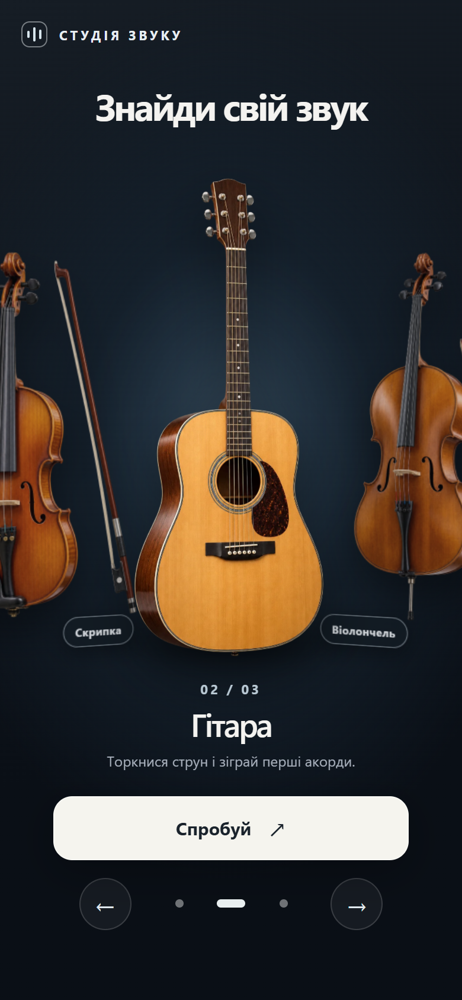
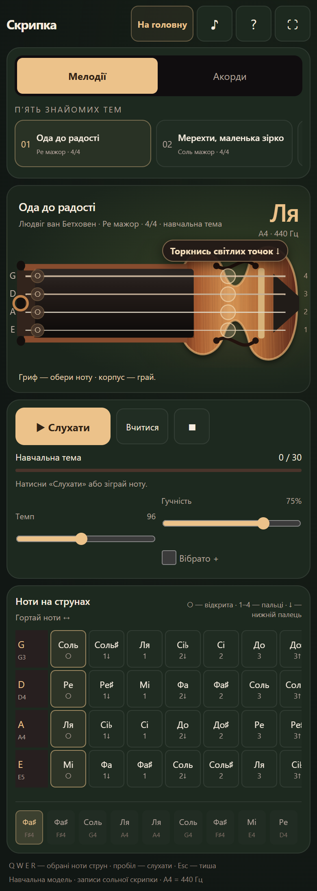
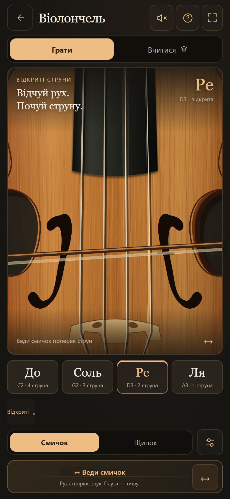
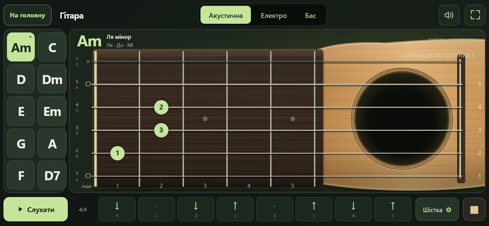

# Студія звуку — знайди свій звук

Інтерактивна музична студія українською: обирай скрипку, гітару або віолончель і грай просто у браузері. Торкайся струн, слухай мелодії, пробуй акорди й проходь навчальні вправи. Сайт працює без реєстрації та встановлення застосунку.

**[Відкрити сайт](https://violin-cherry-velvet.svalerchik.chatgpt.site/)** · [Можливості](#можливості) · [Мобільні скріншоти](#мобільні-скріншоти) · [Локальний запуск](#локальний-запуск) · [Перевірки](#перевірки) · [Ліцензія](#ліцензія-та-ресурси)

Опис і скріншоти відповідають локальному коду репозиторію станом на **11 жовтня 2026 року**. Усі три студії доступні з головної сторінки.

## Мобільні скріншоти

### Головна та інструменти

<table>
  <tr>
    <th width="33%">Вибір інструмента</th>
    <th width="33%">Скрипка</th>
    <th width="33%">Віолончель</th>
  </tr>
  <tr>
    <td valign="top"><a href="docs/screenshots/home-mobile.png"></a></td>
    <td valign="top"><a href="docs/screenshots/violin-mobile.png"></a></td>
    <td valign="top"><a href="docs/screenshots/cello-mobile.png"></a></td>
  </tr>
</table>

### Гітара — телефон у горизонтальній орієнтації

<a href="docs/screenshots/guitar-mobile.png"></a>

Знімки зроблено з локального `dist/` у Chromium з емуляцією телефона й сенсорного введення: **390 × 844 CSS px** для портретних сторінок і **844 × 390 CSS px** для гітари, масштаб зображень — 2×. Скрипку показано на всю висоту сторінки з вертикальним прокручуванням. Натисни на зображення, щоб відкрити оригінал. Це браузерна емуляція, а не знімки з фізичного телефона.

## Можливості

| Сторінка | Маршрут | Що можна робити |
| --- | --- | --- |
| Головна | `/` | Обирати інструмент свайпом, стрілками або кнопками каруселі та відкривати його студію. |
| Скрипка | `/studio/` | Грати на чотирьох струнах, слухати п’ять мелодій, вчити ноти та пробувати акорди. |
| Гітара | `/guitar/` | Перемикати акустичну, електрогітару й бас, грати десять акордів, бій і перебір. |
| Віолончель | `/cello/` | Грати смичком і щипком, обирати відкриті струни та першу позицію, проходити чотири вправи. |

### Скрипка

- Чотири струни **G · D · A · E**, вибір нот на грифі та гра дотиком по корпусу інструмента.
- П’ять навчальних тем: «Ода до радості», «Мерехти, маленька зірко», «Брате Якове», «Зелені рукави» та «Щедрик».
- Прослуховування, режим «Вчитися», підказки наступної ноти й прогрес поточної вправи.
- Десять акордів, арпеджіо та одночасне звучання двох сусідніх струн.
- Темп, гучність і вібрато. Звук використовує вбудовані записи скрипки.

На вузькому екрані список мелодій і таблицю нот можна гортати горизонтально, а всю сторінку — вертикально.

### Гітара

- Три інструменти: **акустична гітара, електрогітара та чотириструнний бас**.
- Десять акордів: **Am, C, D, Dm, E, Em, G, A, F, D7**. Гриф показує пальці, відкриті й заглушені струни та баре.
- Ручна гра окремими струнами або рухом поперек них; можна перемикати акорди під час гри.
- Схеми бою й перебору, циклічне прослуховування, темп, гучність і приглушення струн.
- Звук генерується локально фізичною моделлю струн, без зовнішніх аудіосемплів.

Інтерфейс гітари розраховано на горизонтальну робочу область. У портретній орієнтації він повертається на 90°; для зручної гри поверни телефон горизонтально.

### Віолончель

- Чотири струни **C · G · D · A**, великий план грифа та зона руху смичка.
- «Смичок»: веди пальцем поперек струн або нижньої зони. Рух створює звук, зупинка його гасить; кнопка **↔** відтворює окремий штрих.
- «Щипок»: торкайся струн або проводь поперек них для окремих щипків.
- Перша позиція з позначками пальців; чотири власні вправи: «Чотири голоси», «Діалог струн», «Перші кроки» та «Тиха мелодія».
- Прослуховування вправ і локальне збереження їх завершення. Перевіряється послідовність нот; точність ритму й постановка руки не оцінюються.
- Гучність, темп, відтінок звуку, вібрато й метроном. Звук синтезується локально, без чужих записів віолончелі.

Віолончель зберігає портретну орієнтацію; на коротких екранах навчальні елементи доступні через вертикальне прокручування.

## Як почати грати

1. Відкрий головну сторінку, обери інструмент і натисни **«Спробуй»**.
2. Торкнися струни або кнопки звуку, щоб браузер дозволив відтворення аудіо.
3. Обери мелодію, акорд або вправу й грай дотиками. Кнопки довідки пояснюють керування всередині студій.

Вибрані налаштування, а для віолончелі й завершені вправи, зберігаються через `localStorage` у поточному браузері. Вони не синхронізуються між пристроями й можуть зникнути після очищення даних сайту.

### Клавіатура

| Студія | Керування |
| --- | --- |
| Скрипка | **Q W E R** — обрані ноти чотирьох струн; **пробіл** — прослуховування; **Esc** — тиша. |
| Гітара | **1–0** — акорди; **↑ ↓** — бій; **Q W E R T Y** — струни; **пробіл** — ритм; **Esc** — тиша. |
| Віолончель | **Q W E R** — струни; **0–4** — пальці; **пробіл** — один штрих; **Esc** — тиша. |

## Локальний запуск

Сайт написано на **HTML, CSS та JavaScript**, використовує **Canvas 2D** і **Web Audio API**. Фреймворк, встановлення npm-пакетів і збірка для запуску не потрібні. Потрібні браузер із JavaScript та Python для локального HTTP-сервера.

Із кореня репозиторію виконай:

```sh
python -m http.server 8000 --bind 127.0.0.1 --directory dist
```

Відкрий **[http://127.0.0.1:8000/](http://127.0.0.1:8000/)**. Сервер зупиняється через **Ctrl+C**.

Для перевірки на телефоні в тій самій локальній мережі:

```sh
python -m http.server 8000 --bind 0.0.0.0 --directory dist
```

На телефоні відкрий `http://<локальна-IP-адреса-комп’ютера>:8000/`. За потреби дозволь Python доступ до приватної мережі у брандмауері.

### Автономні HTML

Кожен інструмент також має окремий файл, який можна відкрити у браузері без сервера й мережі:

- [Скрипка — Violin_Studio.html](standalone/Violin_Studio.html)
- [Гітара — Guitar_Studio.html](standalone/Guitar_Studio.html)
- [Віолончель — Cello_Studio.html](standalone/Cello_Studio.html)

Ці файли містять власні стилі, скрипти й необхідні вбудовані ресурси. Для роботи з навігацією сайту використовуй локальний сервер із `dist/`.

**Копії не синхронізуються автоматично.** Сайтна й автономна віолончель наразі побайтно однакові. Скрипка та гітара мають відмінності між `dist/` і `standalone/`; перед зміною обирай потрібний варіант і перевіряй, чи слід оновити другу копію.

## Структура репозиторію

```text
musical-instruments-site/
├── dist/                         # Статичні файли сайту для публікації
│   ├── index.html                # Головна з каруселлю інструментів
│   ├── studio/index.html         # Скрипка
│   ├── guitar/index.html         # Гітара, електрогітара та бас
│   ├── cello/index.html          # Віолончель
│   ├── instruments/              # Зображення інструментів
│   ├── ensemble-preview-v3.png   # Зображення для поширення посилання
│   └── favicon.svg
├── standalone/                   # Автономні HTML трьох студій
├── docs/screenshots/             # Мобільні скріншоти для цього README
├── references/                   # Вихідні зображення й дизайн-референси
├── tests/cello-regression.cjs    # Браузерні регресії віолончелі
├── .openai/hosting.json          # Конфігурація статичного хостингу
├── LICENSE                       # Unlicense
└── README.md
```

`backups/` містить локальні архіви попередніх випусків і виключений із Git. Залежності, секрети та тимчасові результати перевірок також виключені через `.gitignore`.

## Перевірки

Під час оновлення документації всі чотири сторінки відкрито з локального сервера в мобільній емуляції Chromium: помилок JavaScript і горизонтального переповнення сторінок не виявлено. Знімки переглянуто візуально. Ця перевірка не підтверджує роботу на фізичному iPhone або в Safari.

Для віолончелі є окремий набір регресій. Потрібні **Node.js**, доступний модуль **`playwright-core`** і встановлений **Chromium**:

```sh
node --test tests/cello-regression.cjs
```

Якщо модуль і браузер встановлено окремо, задай абсолютні шляхи через змінні середовища. Приклад для PowerShell:

```powershell
$env:PLAYWRIGHT_MODULE = 'C:\tools\node_modules\playwright-core'
$env:CELLO_CHROMIUM_PATH = 'C:\tools\chromium\chrome.exe'
node --test tests/cello-regression.cjs
```

Заміни приклади шляхів на фактичні. Необов’язкова `CELLO_QA_OUTPUT_DIR` задає папку для результатів і тестових знімків; такі матеріали зберігай поза відстежуваними файлами. Тест використовує окремий браузерний профіль з увімкненим sandbox Chromium.

Набір охоплює розміщення позначок на восьми розмірах екрана, смичок і щипок, повторні ноти, клавіатуру, вправи, діалоги, переривання й відновлення звуку, поліфонію та однаковість двох HTML-копій віолончелі. Автоматизовані регресії скрипки та гітари в цьому репозиторії наразі відсутні.

## Публікація та робота з кодом

Джерело статичного сайту — **`dist/`**, як зазначено в [конфігурації хостингу](.openai/hosting.json). Документація й скріншоти лежать поза цією папкою та не потрапляють до сайту.

Останній зафіксований у попередній документації випуск — **версія 5 від 11 жовтня 2026 року**, source commit `fd1369d7bbde502382c5b9feb7d4a883a0fa8c7a`. Оновлення цього README не є новим deploy і не змінює опублікований сайт.

Перед змінами перевіряй `git status --short`, а перед commit — `git diff` і `git diff --cached`. Код, документацію, тести й нові скріншоти слід відстежувати в Git. Репозиторій: [Valerii-S84/musical-instruments-site](https://github.com/Valerii-S84/musical-instruments-site).

Публікація сайту й push на GitHub — окремі дії. Перед deploy підготуй перевірений commit, резервну копію та спосіб повернення попереднього випуску.

## Ліцензія та ресурси

Власний код, тексти та створені для проєкту зображення доступні за **[Unlicense](LICENSE)**: їх можна вільно копіювати, змінювати, поширювати та використовувати навіть комерційно, без вимоги вказувати автора. Ця ліцензія стосується матеріалів, права на які належать авторам проєкту.

Вбудовані записи скрипки походять із [VSCO 2 CE](https://github.com/sgossner/VSCO-2-CE) і поширюються за **CC0 1.0**. Джерело, авторів і текст ліцензії збережено в HTML скрипкової студії. Вони не є матеріалом, на який автори цього проєкту накладають Unlicense.
